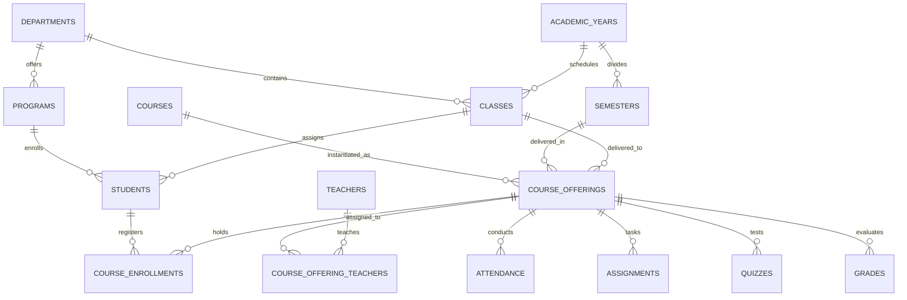

# Student Learning Analytics System (SLAS)
## Database Architecture & Relationship Audit
**Document Version:** 1.0.0  
**Phase:** Phase 0 – Project Audit & Architecture Mapping  
**Date:** November 11, 2026  
**Author:** Senior System & Database Architect  

---

## 1. Executive Summary

A comprehensive read-only audit of the production-oriented university SLAS database (`student_learning_analytics` on MySQL 8.4) was conducted. The schema contains **48 tables** (inclusive of Laravel queue/cache system tables).

### Critical Quantitative Audit of Live Data
| Entity Table | Active Rows | Key Relationship Notes |
| :--- | :--- | :--- |
| `academic_years` | 5 | Spans `2023-2024` through `2027-2028`. Active year: `2026-2027` (id=2). |
| `semesters` | 10 | 2 semesters per academic year. Active: Semester 1 2026-2027 (id=3). |
| `departments` | 3 | Computer Science (1), Information Technology (2), Business Administration (3). |
| `programs` | 8 | BSCS, BSE, BSIT, BBA, CS, SE, IT, BA. |
| `classes` | 13 | Cohort section representations: e.g. `CS-Y1-2026-2027`, `IT-Y2-2025-2026`. |
| `courses` | 8 | Course catalog definitions with direct `teacher_id` foreign key. |
| `teachers` | 4 | Teacher profiles linked 1:1 with `users` (`user_id`). |
| `students` | 14 | Students linked 1:1 with `users`, with `department_id`, `class_id`, `program_id`. |
| `users` | 24 | 17 students, 5 teachers, 2 admins. |
| `course_enrollments`| 1,120 | Composite link: `student_id` + `course_id` + `semester_id`. |
| `class_teacher` | 0 | Pivot created 2026-11-05 (`class_id`, `teacher_id`, `course_id`). Currently empty. |
| `attendance` | 160 | Course session attendance records (`course_id`, `teacher_id`, `semester_id`). |
| `attendance_details`| 1,520 | Student attendance entries (`present`: 1081, `absent`: 217, `late`: 222). |
| `assignments` | 97 | Course assignments (`course_id`, `teacher_id`, `semester_id`, `assignment_type`). |
| `assignment_submissions`| 624 | Student submissions (`graded`: 624). |
| `assignment_attempts`| 0 | Alternate attempt table created 2026-10-02 (quiz/true-false uploads). |
| `quizzes` | 96 | Course quizzes (`course_id`, `teacher_id`, `semester_id`). |
| `quiz_attempts` | 625 | Student attempts (`completed`: 624, `in_progress`: 1). |
| `quiz_answers` | 400 | Student individual question responses. |
| `grades` | 400 | Student course grades (`finalized`: 400). |
| `risk_assessments` | 1,120 | Student risk assessment scores and factors (`low`: 554, `medium`: 390, `high`: 176). |
| `performance_records`| 400 | Calculated period performance metrics per student/course/semester. |
| `gpa_records` | 140 | Semester GPA records per student. |

---

## 2. Core Architectural Mappings & Structural Findings

### 2.1 The Course vs Class vs Offering Distinction

In real-world university environments, a physical class section (e.g., Section "K" or "CS-Y1-2026-2027") represents a cohort of students belonging to a department/program for a specific study year. Multiple courses are delivered to this same cohort, each potentially taught by a different teacher.

#### Existing State in Code & Database:
1. `classes`:
   - Columns: `id`, `department_id`, `academic_year_id`, `course_id`, `teacher_id`, `name`, `code`, `year_level`, `day_of_week`, `start_time`, `end_time`, `room`, `status`.
   - Observation: Currently, `classes` has nullable `course_id` and `teacher_id` columns from early migrations, but in the seeded data and modern university structure, students belong to `classes` (via `students.class_id`), representing physical cohorts.
2. `courses`:
   - Columns: `id`, `department_id`, `teacher_id`, `course_code`, `course_name`, `academic_year`, `semester`, `credit`, `credits`, `status`.
   - Observation: Currently, `courses` holds the course catalog identity (e.g. `CS101 - Database Systems`), but also has a direct `teacher_id` foreign key.
3. `class_teacher`:
   - Columns: `id`, `class_id`, `teacher_id`, `course_id`, `timestamps`.
   - Added via migration `2026_11_05_000001_create_class_teacher_table.php`.
   - Unique index: `(class_id, teacher_id, course_id)`.
   - Missing dimensions: Does not store `semester_id`, `academic_year_id`, `status` (`active`, `transferred`, `replaced`), `assigned_at`, or `ended_at`.

### 2.2 Central Course Offering Architecture Specification

As mandated in Master Requirement Section 4, a central **Course Offering** entity represents the specific delivery of a subject to a cohort for an academic period.

#### Proposed Backward-Compatible Schema Extension:
To support clean teacher replacement without data recreation, a dedicated `course_offerings` and `course_offering_teachers` structure is implemented:

1. **`course_offerings`**:
   - `id`: `bigint unsigned AUTO_INCREMENT` (PK)
   - `course_id`: `bigint unsigned` (FK -> `courses.id`, restrictOnDelete)
   - `class_id`: `bigint unsigned NULL` (FK -> `classes.id`, nullOnDelete)
   - `semester_id`: `bigint unsigned` (FK -> `semesters.id`, restrictOnDelete)
   - `academic_year_id`: `bigint unsigned` (FK -> `academic_years.id`, restrictOnDelete)
   - `program_id`: `bigint unsigned NULL` (FK -> `programs.id`, nullOnDelete)
   - `study_year`: `tinyint unsigned default 1` (Year 1, 2, 3, 4)
   - `section_name`: `varchar(50) NULL` (e.g. "K", "A", "Morning")
   - `status`: `varchar(20) default 'active'` ('active', 'completed', 'cancelled')
   - Timestamps & SoftDeletes

2. **`course_offering_teachers`**:
   - `id`: `bigint unsigned AUTO_INCREMENT` (PK)
   - `course_offering_id`: `bigint unsigned` (FK -> `course_offerings.id`, cascadeOnDelete)
   - `teacher_id`: `bigint unsigned` (FK -> `teachers.id`, cascadeOnDelete)
   - `role`: `varchar(30) default 'primary'` ('primary', 'assistant', 'substitute')
   - `status`: `varchar(20) default 'active'` ('active', 'transferred', 'ended')
   - `assigned_at`: `timestamp NULL`
   - `ended_at`: `timestamp NULL`
   - Timestamps
   - Unique constraint: `(course_offering_id, teacher_id, status)`

3. **Learning Dataset Anchoring**:
   - All existing learning tables (`attendance`, `assignments`, `quizzes`, `grades`, `risk_assessments`) already possess `(course_id, semester_id)`.
   - By adding nullable `course_offering_id` to `attendance`, `assignments`, `quizzes`, `grades`, and backfilling them from existing `(course_id, semester_id)` pairings, we ensure 100% backward compatibility without dropping a single existing record.

---

## 3. Teacher Replacement Logic & Security

When **Teacher A** is replaced by **Teacher B** for Course Offering #42:
1. `course_offering_teachers` row for Teacher A has `status` updated to `'transferred'` or `'ended'`, and `ended_at = now()`.
2. A new `course_offering_teachers` row is inserted for Teacher B with `status = 'active'`, `assigned_at = now()`.
3. The `Course Offering` ID remains **#42**.
4. All student enrollments, attendance history, assignment submissions, quiz attempts, and grade records remain tied to Course Offering #42.
5. Teacher B immediately gains access to all historical and current learning records.
6. Teacher A loses operational write/read access to Course Offering #42 (unless granted special historical audit read permission).
7. Zero student records are duplicated, erased, or orphaned.

---

## 4. Verification and Non-Destructive Safety Rules
- Existing `courses.teacher_id` will remain populated to preserve legacy queries.
- Existing `class_teacher` will be synchronized to ensure legacy admin controllers continue functioning.
- No existing columns will be renamed or dropped.
- Database transactions (`DB::transaction`) are enforced on all assignment mutations.
