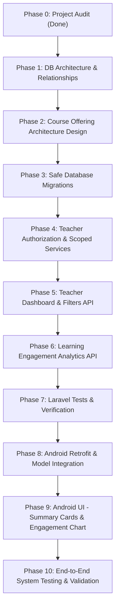

# Student Learning Analytics System (SLAS)
## Master Implementation Plan: Teacher Module
**Document Version:** 1.0.0  
**Phase:** Phase 0 – Project Audit & Master Architecture Plan  
**Date:** November 11, 2026  
**Author:** Senior Software Architect & Lead Backend Engineer  

---

## 1. Project Background & Context

SLAS is an established, production-grade university Student Learning Analytics System comprising:
- **Backend:** Laravel 12 on PHP 8.4 with MySQL, Sanctum token authentication, existing role-based access control, Eloquent models, and SQLite in-memory test suite.
- **Mobile Client:** Android Java with Material Components, Retrofit 2, OkHttp 3, Gson, MPAndroidChart, EncryptedSharedPreferences (`SessionManager`), and existing Fragment/Activity navigation.

The goal is to implement the **Teacher Module** end-to-end with strict authorization, real analytics data calculation, dynamic filtering, and complete teacher data isolation—without breaking existing student or admin workflows and without destructive database modifications.

---

## 2. Phase-by-Phase Execution Roadmap

### Phase 0: Complete Project Audit (COMPLETED)
- Audited all 48 database tables and 57 migrations.
- Profiled live database records across all learning entities (1,120 enrollments, 160 attendances, 1,520 attendance details, 97 assignments, 624 submissions, 96 quizzes, 625 quiz attempts, 400 grades, 1,120 risk records).
- Audited Android project architecture (`TeacherDashboardFragment`, `fragment_teacher_dashboard.xml`, `ApiClient`, `SessionManager`, `ApiService`).
- Verified baseline tests pass (role authorization test suite confirmed passing on SQLite).
- Verified Android builds successfully via Gradle (`assembleDebug` clean).

### Phase 1: Document Existing Database Architecture & Relationships (COMPLETED)
- Produced `SLAS_DATABASE_RELATIONSHIP_AUDIT.md`.
- Documented key entities: `courses`, `classes`, `class_teacher`, `students`, `teachers`, `attendance`, `assignments`, `quizzes`, `grades`.
- Documented data flow, index definitions, and primary/foreign key mappings.

### Phase 2: Design Course Offering and Teacher Assignment Solution
- Define `course_offerings` and `course_offering_teachers` data structures.
- Map existing `(course_id, semester_id)` learning datasets to course offerings.
- Design teacher assignment replacement logic:
  - Replacing Teacher A with Teacher B updates assignment history.
  - Learning records (attendance, submissions, attempts, scores) remain anchored to the offering ID.
  - Zero deletion or replication of student records.

### Phase 3: Implement Safe Database Migrations
- Create migration: `add_course_offerings_and_assignments_tables`.
  - Non-destructive, nullable foreign keys.
  - Automatic backfill seeder script mapping existing courses and classes into offerings.
  - Strict preservation of existing tables (`courses`, `classes`, `class_teacher`).
- Verify migration execution on MySQL without dropping any tables.

### Phase 4: Implement Laravel Teacher Authorization & Reusable Services
- Create `App\Services\TeacherAuthorizationService`:
  - `resolveTeacher(User $user): Teacher`
  - `getAuthorizedOfferingIds(Teacher $teacher): Collection`
  - `authorizeOffering(Teacher $teacher, int $offeringId): CourseOffering`
  - `authorizeClass(Teacher $teacher, int $classId): ClassRoom`
- Create `App\Policies\CourseOfferingPolicy`:
  - Enforce access control on offerings, sessions, assignments, and grades.

### Phase 5: Implement Teacher Dashboard Summary & Filters API
- Refactor/enhance `DashboardController::teacher()` and dedicated `TeacherDashboardController`:
  - Card 1: `total_students` (scoped distinct count).
  - Card 2: `my_courses` (scoped distinct courses).
  - Card 3: `at_risk_students` (scoped active medium/high risk).
  - Card 4: `pending_scores` (scoped pending submissions and ungraded sessions).
- Implement `GET /api/teacher/filters`:
  - Returns cascading options (`academic_years`, `semesters`, `programs`, `study_years`, `courses`, `classes`) based on teacher's assignments.

### Phase 6: Implement Learning Engagement Analytics API
- Implement `TeacherAnalyticsService`:
  - Attendance Rate: Present / Total Expected.
  - Assignment Completion: On-time vs Late vs Missed.
  - Homework Completion: Separately calculated.
  - Quiz Completion: Completed Attempts / Expected Attempts.
- Implement `GET /api/teacher/analytics`:
  - Validates query filters against teacher's authorized scope.
  - Returns structured engagement percentage comparison.
  - Gracefully handles empty data (returns 0% or empty state with nulls, preventing division-by-zero).

### Phase 7: Write & Run Comprehensive Laravel Feature Tests
- Feature tests in `tests/Feature/TeacherModuleFeatureTest.php`:
  1. Teacher A accesses assigned offering -> 200 OK.
  2. Teacher A accesses Teacher B's offering -> 403 Forbidden.
  3. Scoped filter options only show assigned items.
  4. Summary card counts match teacher's assigned scope.
  5. Engagement metrics calculate accurately from real records.
  6. Empty datasets return graceful empty states.
  7. Teacher replacement transfers write/read access while preserving learning history.
  8. Unrelated teachers cannot access another teacher's class offering.
  9. Existing auth, student, and admin tests remain green.

### Phase 8: Integrate Teacher APIs into Android Java
- Update `ApiService.java` with typed Retrofit endpoints:
  - `getTeacherDashboardSummary()`
  - `getTeacherFilters()`
  - `getTeacherAnalytics(params)`
- Create response models in `com.social7.studentlearnanalytics.model`:
  - `TeacherDashboardData`, `TeacherFilterData`, `TeacherAnalyticsResponse`, `LearningEngagementItem`.

### Phase 9: Update Teacher Dashboard UI in Android
- In `fragment_teacher_dashboard.xml`:
  - Add explicit view IDs to the four existing cards:
    - `tvTotalStudentsCount`
    - `tvMyCoursesCount`
    - `tvAtRiskCount`
    - `tvPendingScoresCount`
  - Keep card layout, colors, icons, elevations, and order 100% identical.
  - Replace the single `Performance Overview` line chart card with the `Student Learning Engagement Overview`:
    - Compact horizontal/grid filter selectors (`Spinner` or Material `AutoCompleteTextView`):
      * Generation, Major, Academic Year, Study Year, Semester, Course, Class.
    - Grouped Bar Chart (`BarChart` from `MPAndroidChart`) comparing:
      * Attendance, Assignment, Homework, Quiz.
      * Color coded: Completed (Green `#22C55E`), Late (Orange `#F59E0B`), Missed (Red `#EF4444`).
    - Loading indicator (`ProgressBar`), Error state with Retry button, Empty state view.
- In `TeacherDashboardFragment.java`:
  - Bind dynamic metrics to summary cards.
  - Populate filter dropdowns from API.
  - Render real Grouped Bar Chart from API response.

### Phase 10: End-to-End Workflow Testing & Validation
- Verify Android app build and execution.
- Validate API network traffic and Bearer token inclusion.
- Validate dynamic filtering and chart refresh on selection change.
- Confirm zero regressions in existing student and admin features.

---

## 3. Risk Management & Rollback Strategy

| Risk | Impact | Mitigation Strategy |
| :--- | :--- | :--- |
| Schema modification locks or corrupts existing data | High | All migrations are strictly non-destructive (`ADD COLUMN NULLABLE`, `CREATE TABLE IF NOT EXISTS`). Database backup taken prior to execution. |
| Existing legacy code querying `courses.teacher_id` breaks | High | Synchronize both old `courses.teacher_id` and new `course_offerings` assignments. |
| Android layout regression on diverse device screens | Medium | Use responsive `NestedScrollView` with wrap_content constraints; test on multiple screen sizes. |
| Slow aggregation queries on large learning datasets | Medium | Proper composite indexes on `(course_offering_id, status)` and `(student_id, semester_id)`. |
